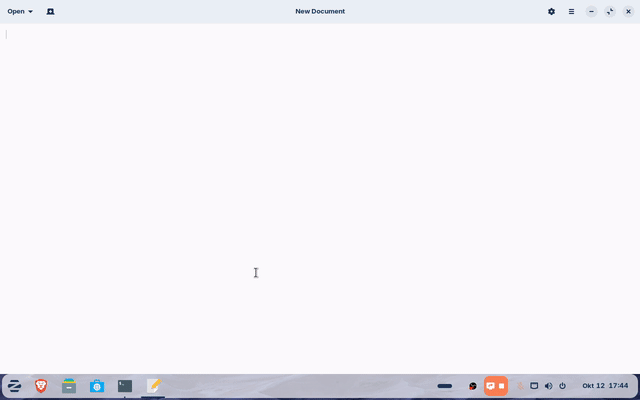
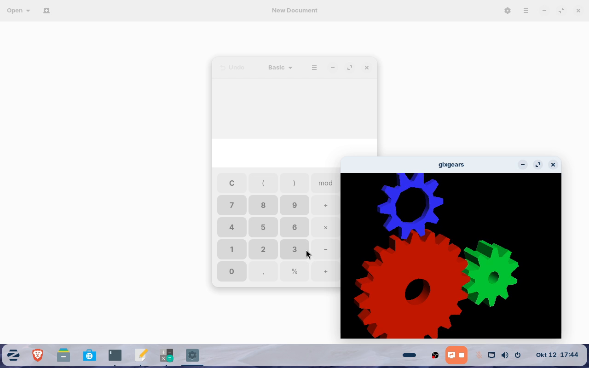

# Rekaman layar OBS yang mulus di VM Linux

**Wayland · render software (tanpa GPU) · ramah RDP**

Panduan praktis dan terukur untuk memperbaiki **rekaman layar OBS yang
patah-patah di dalam mesin virtual (VM) Linux** yang tidak punya akselerasi GPU
(render software via llvmpipe/swrast).

Studi kasus nyata: OBS Studio membuang **84,2 %** dari seluruh frame di sebuah VM
Zorin OS (≈ 9 fps dari target 60 fps). Setelah perbaikan, jalan **stabil 30 fps
dengan 0,0 % frame terbuang**, *selagi sesi RDP tetap tersambung*.

> Diuji dengan OBS Studio 30.0.2 di Zorin OS 17 (GNOME 46, Wayland) pada guest
> QEMU/KVM dengan layar virtual (`Virtual-1`, 1280×800) dan `gnome-remote-desktop`
> untuk RDP.

---

## Daftar isi

- [Gejala](#gejala)
- [TL;DR — perbaikannya](#tldr--perbaikannya)
- [Kenapa bisa terjadi](#kenapa-bisa-terjadi)
- [Langkah demi langkah](#langkah-demi-langkah)
- [Sebelum / Sesudah](#sebelum--sesudah)
- [Demo](#demo)
- [Ukur sendiri](#ukur-sendiri)
- [Pemecahan masalah](#pemecahan-masalah)
- [Kapan cara ini tidak cukup](#kapan-cara-ini-tidak-cukup)
- [Isi repositori](#isi-repositori)
- [Lisensi](#lisensi)

---

## Gejala

- Rekaman terlihat patah-patah, atau kursor/animasi seperti "melompat".
- Animasi desktop (buka/tutup jendela, ganti workspace) tampak **hilang**.
- CPU OBS tidak terlalu terpakai, tetapi frame tetap terbuang.
- Log OBS berisi baris seperti:

  ```
  Output 'adv_file_output': Number of lagged frames due to rendering lag/stalls: 4169 (84.2%)
  ```

## TL;DR — perbaikannya

Di **Settings → Video** dan **Settings → Output**:

| Setelan | Nilai |
|---|---|
| Base (Canvas) Resolution | **sama dengan layar Anda** (mis. `1280x800`) |
| Output (Scaled) Resolution | **sama dengan Base** (tanpa scaling!) |
| Common FPS Values | **30** |
| Scale Filtering | Bilinear (tidak berpengaruh bila Base = Output) |

Di **Settings → Output → Recording** (mode Advanced, `x264`):

| Setelan | Nilai |
|---|---|
| Encoder | `x264` (software — tidak ada encoder GPU yang bekerja di VM) |
| Rate Control | `CRF` |
| CRF | `20` |
| Preset | **`superfast`** |
| Profile | `high` |
| Keyframe Interval | `2` detik |
| Format | `mkv` (remux ke mp4 nanti) |

Lalu:

- **Matikan pratinjau OBS** — View → hilangkan centang *Preview* (atau set
  `PreviewEnabled=false` di `global.ini`). Bisa memakan ~10 ms/frame.
- **Matikan pemadam layar** agar rekaman tidak menangkap layar kosong.
- **Tutup aplikasi berat** (software center, browser dengan banyak tab, dll).

Selesai. Tanpa perlu GPU.

## Kenapa bisa terjadi

Di dalam VM tanpa GPU passthrough, setiap piksel yang disentuh OBS diproses oleh
**CPU**. Untuk setiap frame OBS harus:

1. menerima frame hasil tangkapan dari PipeWire (screen capture Wayland),
2. **mengonversi** format warna (mis. BGRA → NV12),
3. **menskalakan** ke resolusi output,
4. **mengenkode** dengan x264.

Langkah 2–4 yang paling mahal. Pada 1080p, `render_convert_texture` saja terukur
**~69 ms per frame**. Anggaran 60 fps hanya **16,7 ms**, jadi ~84 % frame
terbuang.

Perbaikannya menyerang biaya tersebut secara langsung:

- **Base = Output** menghapus langkah penskalaan sepenuhnya.
- **30 fps** melipatgandakan anggaran per frame (33,3 ms).
- **`superfast`** membuat encoder lebih murah.
- **Pratinjau dimatikan** menghapus satu proses render tambahan (~11 ms).
- Menjaga resolusi di **ukuran layar asli** memangkas separuh jumlah piksel
  dibanding 1080p.

Hasilnya: waktu render rata-rata turun dari **~80 ms menjadi ~4–12 ms**.

## Langkah demi langkah

### Opsi A — manual (disarankan untuk pertama kali)

1. Buat profil khusus: **Profile → New** (mis. `Smooth30`).
2. Terapkan nilai dari [TL;DR](#tldr--perbaikannya) di atas.
3. Tambah sumber tangkapan layar: **Sources → + → Screen Capture (PipeWire)**,
   lalu pilih monitor pada dialog.
4. Tambah audio: **Desktop Audio** dan **Mic/Aux** (atau mic asli Anda).
5. Matikan pratinjau.
6. Rekam tes singkat lalu periksa log (lihat [Ukur sendiri](#ukur-sendiri)).

### Opsi B — skrip

```bash
# Memasang profil "Smooth30" ke ~/.config/obs-studio (dengan backup dulu)
./scripts/apply-obs-profile.sh
```

Lalu buka OBS dan pilih profil **Smooth30** (menu Profile).

> Skrip hanya memasang *profil baru*; tidak menyentuh scene maupun rekaman Anda.

## Sebelum / Sesudah

Diukur langsung lewat OBS WebSocket API (`scripts/obs-stat.py`), **dengan RDP
tetap tersambung**:

| Metrik | Sebelum | Sesudah |
|---|---|---|
| Frame tertinggal / terbuang | **4169 (84,2 %)** | **0 (0,0 %)** |
| Waktu render rata-rata | ~80 ms | **~4–12 ms** |
| FPS aktif | ~9 | **30,0 (stabil)** |
| CPU OBS | tinggi | ~11–23 % |

Bukti log mentah (sebelum):

```
Output 'adv_file_output': Total frames output: 4916
Output 'adv_file_output': Total drawn frames: 4951
Output 'adv_file_output': Number of lagged frames due to rendering lag/stalls: 4169 (84.2%)
```

## Demo

Tangkapan asli dengan setelan ini (1280×800 @ 30 fps, x264 `superfast`),
direkam di dalam VM — animasi buka-tutup jendela plus jendela OpenGL live,
dikonversi ke GIF:



Bingkai diam dari rekaman yang sama:



## Ukur sendiri

Tak perlu menebak — OBS menyediakan penghitung yang tepat:

1. Aktifkan server WebSocket: **Tools → WebSocket Server Settings → Enable**,
   isi kata sandi.
2. Jalankan skrip pengukur:

   ```bash
   pip install websockets            # atau: sudo apt install python3-websockets
   OBS_WS_PASSWORD='sandi-anda' ./scripts/obs-stat.py --duration 20
   ```

   Skrip mencetak `activeFps`, `averageFrameRenderTime`, dan **persentase render
   terlewat** secara langsung. Target: **< 1 % terlewat**.

3. Atau cukup baca log OBS setelah merekam:

   ```bash
   ./scripts/diagnose.sh
   ```

## Pemecahan masalah

| Masih patah-patah? | Coba |
|---|---|
| Sedikit melebihi anggaran | Turunkan FPS ke **25**, atau preset ke **`ultrafast`** |
| Ingin rasio 16:9 | Output **1280×720** alih-alih 1280×800 |
| Encoder yang jadi botol (lihat `video_thread_time` di log) | Preset `ultrafast`, atau naikkan CRF |
| Seluruh sistem lambat | Tutup aplikasi lain, jangan jalankan pratinjau, rekam ke disk cepat |
| Rekaman layar hitam | Pilih ulang monitor di sumber Screen Capture; pastikan pemadam layar mati |

## Kapan cara ini tidak cukup

Kalau Anda ingin **1080p60 yang mulus**, tidak ada setelan OBS yang bisa
menyelamatkan di VM tanpa GPU. 1080p60 yang stabil butuh **akselerasi perangkat
keras di level host** (virgl, GPU passthrough, atau jalankan OBS di perangkat
asli). Pada render software murni, plafon realistisnya sekitar **720p–800p pada
25–40 fps**.

## Isi repositori

```
README.md                   Dokumen ini
README.id.md                Versi Bahasa Indonesia
assets/demo-smooth.gif      GIF demo (tangkapan asli dengan setelan ini)
assets/recording-screenshot.png  Bingkai diam dari rekaman demo
docs/diagnosis.md           Membaca log OBS & menemukan botolnya
docs/vm-wayland-rdp.md      Khusus VM + Wayland + PipeWire + RDP
docs/reference-settings.md  Alasan tiap setelan
config/basic.ini            Template profil OBS (video/output/audio)
config/recordEncoder.json   Setelan encoder x264
config/scene-template.json  Scene collection tangkapan layar minimal
scripts/diagnose.sh         Kumpulkan info sistem + hitung % render-lag
scripts/obs-stat.py         Statistik langsung via OBS WebSocket
scripts/apply-obs-profile.sh Pasang profil ke OBS
```

## Lisensi

[MIT](LICENSE).
